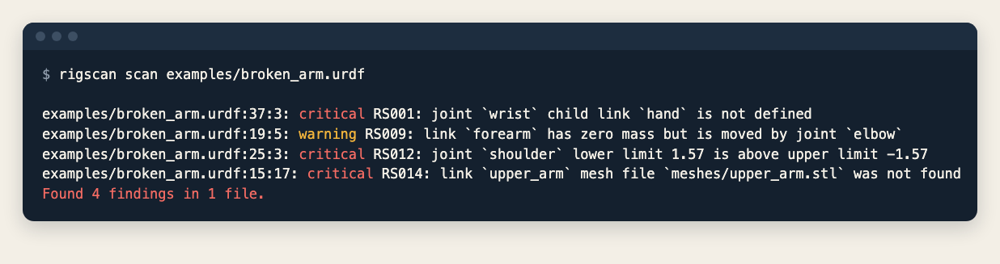

<p align="center">
  <picture>
    <source media="(prefers-color-scheme: dark)" srcset="assets/logo-dark.svg">
    
  </picture>
</p>

<h1 align="center">Rigscan</h1>

<p align="center"><b>A health check for robot descriptions.</b></p>

<p align="center">

[](https://github.com/michele-xilo/rigscan/actions/workflows/ci.yml)
[](https://codecov.io/gh/michele-xilo/rigscan)


</p>

**Find the missing link, the inverted limit and the mesh that is not there in your URDF, MJCF or USD robot, before the simulator does.**

<p align="center">
  
</p>

## Quick start

```bash
cargo install --git https://github.com/michele-xilo/rigscan rigscan-cli
rigscan scan robot.urdf          # or a directory: it finds URDF, MJCF and USD files itself
```

No config and no simulator needed. Exit code 0 means no critical findings and 1 means at least one, so it works as a
CI step. To try it on a robot with known problems, run it on [examples/broken_arm.urdf](examples/broken_arm.urdf).
Every option and output format (`text`, `full`, `report`, `json`) is in [docs/usage.md](docs/usage.md).

## Try it in your browser

The [viewer](https://michele-xilo.github.io/rigscan/) runs Rigscan as WebAssembly: drop a URDF, MJCF or USD file (or a
folder) and see the robot in 3D (primitives and STL or OBJ meshes), the kinematic tree coloured by health, the findings, and the source line each one
points at. Nothing is uploaded. It is also the test of the WebAssembly build.

## What it catches

- A joint that points at a link that does not exist, two links with the same name, a link with two parents, a loop,
  or more than one root.
- Negative or zero mass, and inertia that no real body can have.
- A joint whose `lower` limit is above its `upper`, or with no limit, effort or velocity.
- A mesh file that is not where the description says, and a `mimic` of a joint that is not there.
- MJCF: a default class, mesh asset or `include` that does not exist.
- USD: a joint that connects a body to itself, a body with no mass and no collider, joints without an articulation
  root, and a reference or sublayer that cannot be found.
- A file that does not parse, with the line and column of the problem.

22 rules in all, each with its ID, severity and a fix, listed in [docs/rules.md](docs/rules.md).

## Why Rigscan

- **Fast.** Several times faster than the loaders it was compared with (table below), and the output is the same on
  every run, so it fits on every save and in CI over a whole robot library.
- **Nothing to set up.** One binary, no Python, no simulator, no license.
- **One tool for three formats.** URDF, MJCF and USD are read into one model, so the same structural and physics
  rules run on all of them.
- **Made for CI.** Stable rule IDs, exit codes, JSON output and deterministic, sorted findings.

<!-- compare:summary:start -->
| | Rigscan | Pinocchio 4.1.0 | yourdfpy 0.0.60 |
|---|:-:|:-:|:-:|
| Reads URDF | ✅ | ✅ | ✅ |
| Reads MJCF | ✅ | ❌ | ❌ |
| Reads USD (UsdPhysics) | ✅ | ❌ | ❌ |
| Broken-robot checks flagged | 22 of 22 🏆 | 8 of 22 | 1 of 22 |
| Load time, `talos_full_v2` (107 KiB) | 0.49 ms 🏆 | 1.62 ms | 4.29 ms |
| Rigscan is faster by |  | 3x | 9x |

✅ yes  ❌ no  🏆 best. The tools are loaders, not linters; [docs/comparison.md](docs/comparison.md) has each check and each rig, and MuJoCo.
<!-- compare:summary:end -->

## What is supported

| | Reads | Lints | Converts |
|---|:-:|:-:|:-:|
| URDF | yes | yes | planned |
| MJCF | yes | yes | planned |
| USD (UsdPhysics) | yes | yes | planned |

The library (`rigscan-core`) compiles for WebAssembly and powers the browser viewer; the CLI is the other surface. A
Python wheel, joint sliders in the viewer, SARIF output and URDF/MJCF/USD conversion with a report of what each conversion loses are on the
[roadmap](https://github.com/michele-xilo/rigscan/issues).

## More

- [Usage](docs/usage.md): scanning, output formats, exit codes, the library.
- [Rules](docs/rules.md): every rule ID, what it flags and how to fix it.
- [Comparison](docs/comparison.md): check by check and rig by rig against MuJoCo, Pinocchio and yourdfpy.
- [Brand](docs/brand.md): logo, colours and voice.

> **Early stage.** Pre-alpha and not published yet, so the API will change. Tested on small hand-written fixtures
> and on real robots: 69 URDF files from [example-robot-data](https://github.com/Gepetto/example-robot-data), 127
> MJCF models from [MuJoCo Menagerie](https://github.com/google-deepmind/mujoco_menagerie) and 39 USD stages from
> [newton-assets](https://github.com/newton-physics/newton-assets). Not affiliated with any of the projects above.

## Contributing

```bash
cargo test
cargo build -p rigscan-core --target wasm32-unknown-unknown
```

Bug fixes start with a failing test. Setup, the corpora, benchmarks and how to add a rule are in
[CONTRIBUTING.md](CONTRIBUTING.md) and the [style guide](STYLE_GUIDE.md).

## License

Apache-2.0. See [LICENSE](LICENSE).
